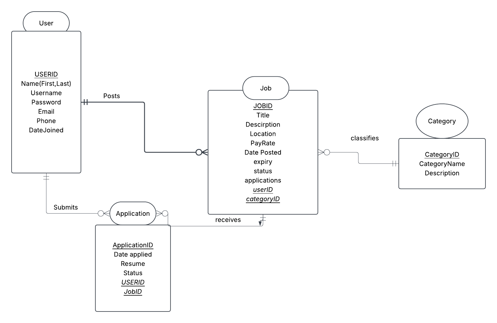

# WDP

a. What problem does your app solve or what purpose does it serve?
    Odd Jobs, gig work for Odd Jobs
    It serves as a way for people to post odd jobs, junk removal / dog sitting / contracting

b. Who is the intended user?

people who need something done but don't know who to call.

c. What actions will users be able to perform (e.g., sign up, add items, search,
comment, etc.)?

actions can be 
for employers -> post job, look at listings
employees -> apply for jobs, look at listings

like fivver or another free lancing option
connecting jobs to people

# Relations
User can post zero or many jobs
Jobs can belong to one user and only one user

One and only one user can can send zero or many applications 
A job can receive zero or many applications
one and only one application per job

a job is categorized by one and only one category
a category can have zero or many jobs in a specific category

